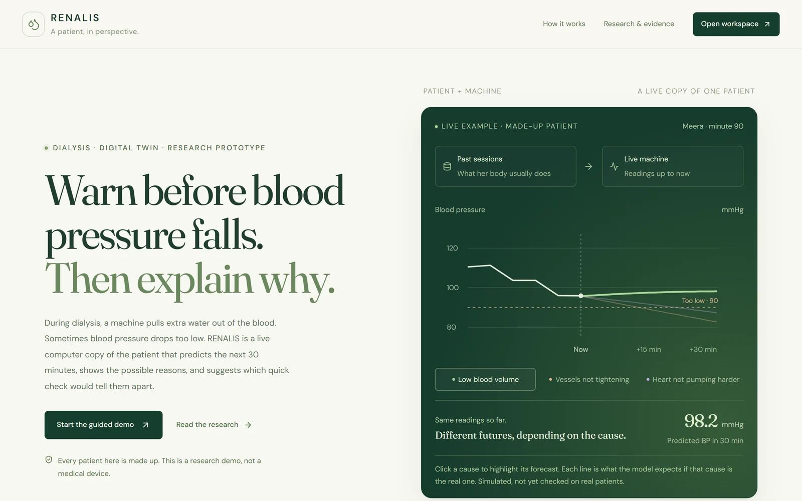
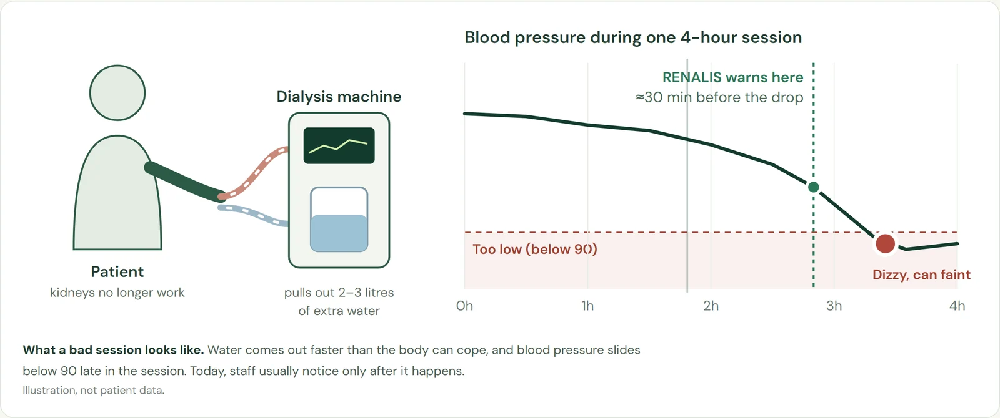
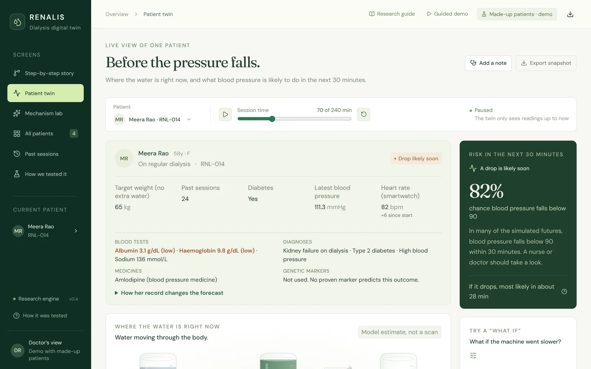
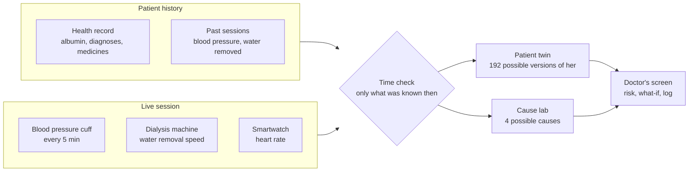
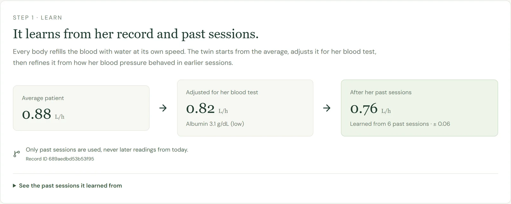
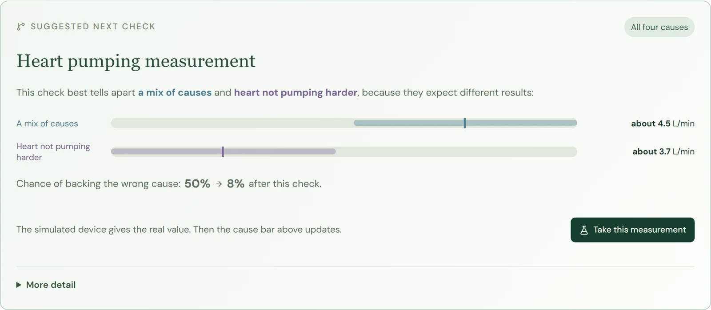
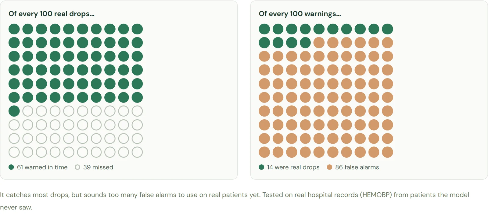

# RENALIS

**A digital twin for dialysis that warns before blood pressure crashes, and shows why.**

[](https://github.com/RAK2315/RENALIS/actions/workflows/verify.yml) [](LICENSE) [](https://renalis-one.vercel.app) [](https://www.youtube.com/watch?v=ZcWNYMtM1tI)

**[Open the live app](https://renalis-one.vercel.app)** · [Watch the demo](https://www.youtube.com/watch?v=ZcWNYMtM1tI) · [How it works](#how-it-works) · [Results](#results-including-what-didnt-work) · [Run it locally](#run-it-locally)



> Research prototype. Every patient in the app is made up. It is not a medical device and has not been tested on real patients in care.
> The free server sleeps when idle, so the first load can take about a minute.

---

## The problem

- During dialysis, a machine removes the extra water that failed kidneys can't. If it removes water faster than the body can refill the blood, **blood pressure falls**. Patients get dizzy, cramp or faint.
- Staff usually notice only after it happens. The same falling number can also have **different causes**, and each needs a different response.
- About **138 million** Indian adults had chronic kidney disease in 2023, the second-highest number in the world ([GBD 2023, The Lancet](https://doi.org/10.1016/S0140-6736(25)01853-7)).



## What RENALIS does

A live virtual copy of one patient, updated as each reading arrives.

| | Step | In plain words |
|---|---|---|
| 1 | **Learn** | Reads her health record (blood tests, medicines) and past sessions to learn how fast her body refills the blood. |
| 2 | **Predict** | Every few minutes, works out the chance her blood pressure falls to 90 or below in the next 30 minutes. |
| 3 | **Explain** | Keeps four possible causes side by side: not enough blood volume, blood vessels not tightening, heart not pumping harder, or a mix. |
| 4 | **Suggest** | Picks the one extra check that would best tell the causes apart, and says whether it's worth the cost. |



### Try it in one minute

1. Open the [step-by-step story for Meera](https://renalis-one.vercel.app/workspace?view=investigation&patient=RNL-014&minute=90).
2. Drag the **session time** slider to minute 50, then 70, then 90. The risk goes from **0%** to about **80%** to **100%**. At minute 70 her blood pressure still looks normal, but the twin warns about 28 minutes ahead.
3. In Step 4, press **Take this measurement** and watch the cause bar shift.

## How it works

Two kinds of data feed one virtual patient:





<details>
<summary><b>More detail on the model</b></summary>

- **History sets the starting point.** The average refill speed (0.88 L/h) is adjusted for her albumin blood test, then refined from six earlier sessions.
- **The twin.** 192 slightly different versions of the patient, each with its own refill speed and body response, run on a simple two-tank water model (blood and tissues). Each new blood pressure reading, and the smartwatch heart rate every 5 minutes, re-weights them. The risk % is the share that fall to 90 or below within 30 minutes.
- **The cause lab.** 48 versions for each of four causes. Heart failure or a beta-blocker in the record makes "heart not pumping harder" more likely at the start.
- **The next check.** For each possible check (re-check blood pressure, blood volume sensor, heart output), it predicts the result each cause expects. A check is useful when the causes expect very different results.
- **Safety checks.** No forecast from future readings, no early warning when pressure is already low, and the warning pauses if the last reading is more than 15 minutes old.
- **Evidence for the record rules.** Beta-blockers slow refill, by drug ([Nadal 2021](https://doi.org/10.1159/000519661)). The albumin link is weak and labelled as our assumption. A sudden fall in heart rate is a warning sign before a crash ([Barnas 1999](https://doi.org/10.1681/ASN.V10122577)), so the twin never reads it as good news.
- **Recorded but not used:** haemoglobin and sodium. **Genetic markers: not used,** because no proven marker predicts this outcome.

Full equations and assumptions: [model card](docs/model-card.md).

</details>



## Results, including what didn't work

We ran three tests. None of them shows yet that RENALIS helps real patients, but each one is honest about where it stands.

**1. Real dialysis records (HEMOBP, a public dataset from Taiwan).** Patients split three ways with no overlap: 563 to learn from, 141 to tune, **176 held back for testing** (18,420 sessions).

| Predicting the next blood pressure reading | Average miss (mmHg) |
|---|---:|
| Just repeat the last reading | 12.2 |
| Live session data | 11.4 |
| Live data + age and sex | 11.3 |
| **Live data + past sessions** | **11.2** |

- **Warnings before a drop to 90 or below** (v0.5): it **caught 60% of drops** and **15% of warnings were right**. Drops are rare (about 2.6 in every 100 moments), so most warnings are still false alarms. In context:
  - A RENALIS warning is **5.8 times** more likely to be right than a random one. The closest published system ([Zhang et al. 2023, NDT](https://doi.org/10.1093/ndt/gfad070)) reaches 5.4 times on the same kind of scoring.
  - 76% of sessions with a drop got a warning first, at about one warning every 7 hours of dialysis.
  - Five facts the hospital already records (weight gained since last session, planned water removal, first reading of the day, recent drops, years on dialysis) cut false alarms by 13%. The change was accepted on tuning patients before looking at test patients.
  - Stricter rules cut more false alarms but miss more drops. There is no free fix with this data.
- **The twin itself on real data: now level with the simple method.** Uncorrected, it missed by 12.8 mmHg against 12.2 for repeating the last reading, because it expected drops that real patients often don't have. A two-number correction learned on training patients only brings it to 12.2, level with the simple method. Its value is explaining *why* pressure falls and testing "what if". HEMOBP has no heart rate or blood tests, so those inputs remain untested on real data.



**2. Stress test (hard made-up cases).** Does picking the smartest check lead to better decisions than just re-checking blood pressure? **At first, no:** on the first 192 cases, re-checking did about as well (average mistake 0.222 vs 0.241). The planner was too sure of sensor models that didn't match the test world. **After one fix, yes:** a more careful planner (it trusts the other sensors less and re-checks blood pressure unless another check is clearly better) was tuned on separate practice cases, then run once on 384 new cases. It made 9% smaller mistakes than re-checking (95% range 6 to 13%), and was "sure but wrong" 44% less often than the plain planner. These are made-up cases, so this shows the logic works, not that it helps patients.

**3. Demo patients.** The twin misses by about 1.9 mmHg on the made-up sessions, against 13.2 for repeating the last reading. The same team built the patients and the model, so this checks the software works, not that it is accurate.

Raw results: [real data](docs/observed-v04.json) · [warnings v0.5](docs/warnings-v05.json) · [twin on real data](docs/twin-hemobp.json) · [warning trade-off](docs/alarm-tradeoff.json) · [stress test](docs/policy-validation-v04.json) · [stress test re-run](docs/policy-validation-v05.json) · [research behind these fixes](docs/research-fixing-open-problems.md)

## Tech stack

| Part | Built with |
|---|---|
| Website | React, TypeScript, Vite, Recharts |
| Model and API | Python, FastAPI, NumPy (particle filter, written from scratch) |
| Real-data test | pandas, scikit-learn (gradient-boosted trees), patient-separated splits |
| Storage | SQLite: every reading, correction and note is kept, never erased |
| Hosting | Vercel (website), Hugging Face Spaces (API) |
| Checks | 57 unit tests, release checks and GitHub Actions on every push |

## Run it locally

Needs Python 3.10 and Node.js 22 or later.

```bash
git clone https://github.com/RAK2315/RENALIS.git
cd RENALIS
python -m venv .venv
.venv/Scripts/python.exe -m pip install -r requirements-lock.txt   # macOS/Linux: .venv/bin/python
npm ci
```

Start the API, then the website, in two terminals:

```bash
.venv/Scripts/python.exe -m uvicorn backend.app:app --port 8000
npm run dev
```

Open [http://127.0.0.1:5173](http://127.0.0.1:5173). On Windows, `scripts/start.ps1` starts both.

Run the checks:

```bash
.venv/Scripts/python.exe -m unittest discover -s tests
npm run build
.venv/Scripts/python.exe scripts/verify-release.py
```

The real-data tests need the HEMOBP files, which are not redistributed here. See [the evaluation script](scripts/evaluate_observed_v04.py).

## Documents

| | |
|---|---|
| Project presentation | [PDF](output/pdf/RENALIS_Project_Presentation_v06.pdf) · [PowerPoint](output/presentations/RENALIS_Project_Presentation_v06_Design_Final.pptx) |
| Architecture diagram | [PDF](output/pdf/RENALIS_Architecture_v06.pdf) · [PowerPoint](output/presentations/RENALIS_Architecture_v06_Professional_Final.pptx) |
| Model details and limits | [Model card](docs/model-card.md) |
| Proposed study with doctors | [Protocol](docs/clinical-study-protocol.md) |
| Demo video (20 min) | [YouTube](https://www.youtube.com/watch?v=ZcWNYMtM1tI) |

## Repository layout

```text
backend/   API, patient twin, cause lab, health records
src/       Website
tests/     Unit tests
scripts/   Real-data tests, release checks, launch script
docs/      Model card, test results, protocols
output/    Presentation and architecture files
```

## Team

**Sigmoid** · Rehaan (solo) · JSS University, Noida · [@RAK2315](https://github.com/RAK2315)

Built for the Happiest Health Digital Twin Challenge 2026.

## License

Code: [MIT](LICENSE). The HEMOBP dataset keeps its CC BY 4.0 licence. Other terms: [third-party notices](THIRD_PARTY_NOTICES.md).
