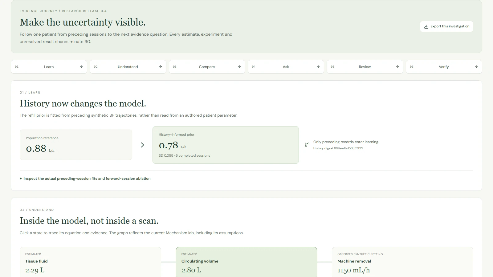
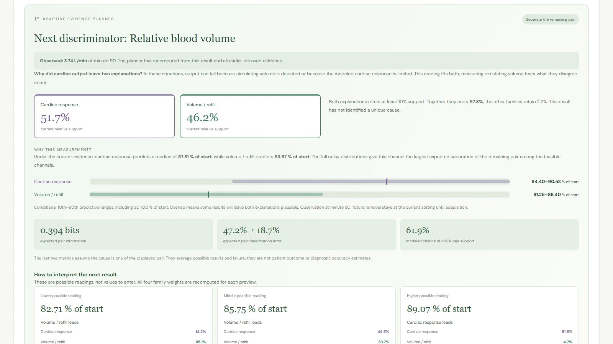
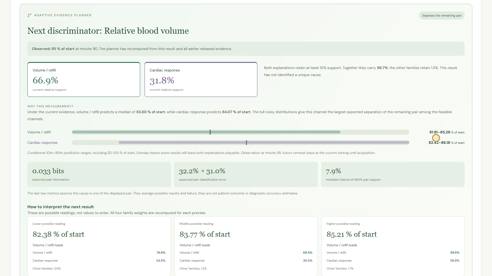
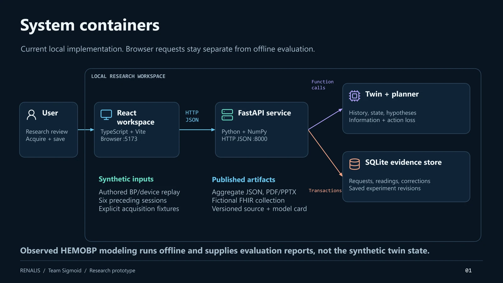

# RENALIS

**An evidence-aware digital twin for dialysis research.**

RENALIS compares competing physiological explanations, identifies the next useful measurement, and shows how an acquired result changes the model's reasoning.

[](https://github.com/RAK2315/RENALIS/actions/workflows/verify.yml) [](LICENSE) [](https://www.youtube.com/watch?v=ZcWNYMtM1tI)

[Watch the demo](https://www.youtube.com/watch?v=ZcWNYMtM1tI) · [Quick start](#quick-start) · [Architecture](#architecture-and-project-presentation) · [Results](#evaluated-outcomes-and-limits) · [Submission checklist](#organizer-submission-checklist)

[](https://www.youtube.com/watch?v=ZcWNYMtM1tI)

## Overview

During a dialysis session, similar blood-pressure histories can be compatible with different hidden physiological processes. RENALIS preserves that disagreement instead of collapsing it into a single explanation. A researcher can inspect the model state, compare hypothetical fluid-removal profiles, preview possible observations, acquire a synthetic device reading, and review the resulting evidence trail.

The application combines a patient-history learner, a four-family particle model, an adaptive measurement planner, and an auditable research workspace. A separate retrospective pipeline evaluates prediction on the public HEMOBP dataset.

**Project status:** working research prototype, software release **0.4**. Built-in patients and device streams are fictional. Clinical deployment, treatment control and prospective patient benefit have not been established.

## Problem statement and healthcare use case

A falling blood-pressure trace alone may not distinguish volume depletion from vascular or cardiac response limitations. A risk score also does not explain which additional measurement could help separate those possibilities.

RENALIS supports **research review during maintenance hemodialysis**. Its central question is: **given the evidence available now, which feasible observation could clarify the remaining disagreement?** The workspace exposes model assumptions, conditional predictions, acquisition constraints and unresolved uncertainty. It does not send treatment commands to a dialysis machine.

## Product walkthrough



The evidence journey keeps six connected stages at the same patient and replay cutoff:

| Stage | What the researcher can inspect |
| --- | --- |
| **Learn** | A refill prior fitted from six preceding completed synthetic sessions, with source fits and lineage |
| **Understand** | Estimated fluid compartments, observed machine settings and authored physiological relationships |
| **Compare** | Volume/refill, vascular, cardiac and mixed-response families, with 48 particles per family |
| **Ask** | Noisy measurement predictions, possible-result previews and the next feasible discriminator |
| **Review** | Acquisitions, failures, artifacts, appended corrections and immutable investigation snapshots |
| **Verify** | Retrospective prediction results and independent synthetic policy results, including negative findings |

### Adaptive measurement selection

The demonstration follows the fictional patient **Meera, RNL-014, at minute 90**. After a cardiac-output reading, the planner recomputes which observation would best separate the surviving explanations.



| Step | Evidence or computation | What changes |
| --- | --- | --- |
| 1. Acquire cardiac output | **3.74 L/min** | Cardiac support is **51.7%** and volume/refill support is **46.2%**. Both remain plausible. |
| 2. Select the next measurement | **Relative blood volume** | The remaining families predict different noisy distributions: medians **83.87%** and **87.81%** of starting volume. |
| 3. Acquire the actual synthetic result | **85.0% RBV** | Support shifts to **66.9%** volume/refill and **31.8%** cardiac. The result remains inconclusive. |
| 4. Reassess | Recompute from released evidence | Continue only if a feasible observation offers useful separation and the current authority guards permit it. |

The planner selects the next question without a manually supplied resolving value. Overlapping predictions can still leave uncertainty. Model support describes compatibility within the authored model bank, not the probability of a clinical diagnosis.

<details>
<summary>View the acquired RBV result</summary>



</details>

[Follow the click-by-click investigation](docs/demo-walkthrough-v04.md#adaptive-follow-up-after-374-lmin).

### Additional research capabilities

- **Action-loss comparison:** evaluate hypothetical profiles while accounting for waiting, acquisition failure and declared burden. Information gain and action value remain separate objectives.
- **Evidence safeguards:** withhold scenario authority for current low BP, stale readings and completed sessions, and expose poor model fit.
- **Longitudinal transport:** explore authored intake/output intervals and later sessions with mass-balance checks.
- **Interoperability example:** export fictional FHIR R4 Patient, Device and BP Observation resources with reference and unit checks.

## Demo video

**[Watch the complete 20-minute demonstration](https://www.youtube.com/watch?v=ZcWNYMtM1tI)**

The video is **Unlisted**, lasts **20:00**, and is available without signing in. Anonymous YouTube player metadata was checked on 20 October 2026. See the [submission verification record](docs/submission-verification.json).

| Timestamp | Chapter |
| --- | --- |
| [00:00](https://www.youtube.com/watch?v=ZcWNYMtM1tI&t=0s) | The problem, product and architecture |
| [05:00](https://www.youtube.com/watch?v=ZcWNYMtM1tI&t=300s) | Competing explanations and adaptive CO-to-RBV investigation |
| [10:00](https://www.youtube.com/watch?v=ZcWNYMtM1tI&t=600s) | Evidence, evaluations and measured limitations |
| [15:00](https://www.youtube.com/watch?v=ZcWNYMtM1tI&t=900s) | Safeguards, reproducibility and next validation steps |

## Quick start

### Requirements

- **Python 3.10**
- **Node.js 22.12 or later**; local verification used Node.js 24
- Git and npm

The built-in demonstration uses local synthetic data and does not require downloading the observed clinical dataset or voice models.

### Install

```powershell
git clone https://github.com/RAK2315/RENALIS.git
cd RENALIS
python -m venv .venv
.venv/Scripts/python.exe -m pip install -r requirements-lock.txt
npm ci
```

On Linux or macOS, use `.venv/bin/python` instead of `.venv/Scripts/python.exe` in these commands.

### Run

Start the API in one terminal:

```powershell
.venv/Scripts/python.exe -m uvicorn backend.app:app --host 127.0.0.1 --port 8000
```

Start the interface in another terminal:

```powershell
npm run dev
```

Open **[http://127.0.0.1:5173/](http://127.0.0.1:5173/)**. For the featured case, open the [minute-90 investigation](http://127.0.0.1:5173/workspace?view=investigation&patient=RNL-014&minute=90). API documentation is available at **[http://127.0.0.1:8000/docs](http://127.0.0.1:8000/docs)** while the API is running.

Windows users can also launch the installed application with `scripts/start.ps1`.

## Architecture and project presentation

The current implementation runs as a React browser workspace, a FastAPI service and a local SQLite evidence store. The inference components share one Python service. The observed-data benchmark runs separately and supplies aggregate evaluation reports.

[](output/pdf/RENALIS_Architecture_v06.pdf)

| Resource | PDF | Editable PowerPoint |
| --- | --- | --- |
| **Architecture** - six views covering containers, inference, request sequence, adaptive planning, persistence and evaluation boundaries | [Architecture PDF](output/pdf/RENALIS_Architecture_v06.pdf) | [Architecture PPTX](output/presentations/RENALIS_Architecture_v06_Professional_Final.pptx) |
| **Project presentation** - 20 slides covering the use case, actual product, model reasoning, results and next steps | [Presentation PDF](output/pdf/RENALIS_Project_Presentation_v06.pdf) | [Presentation PPTX](output/presentations/RENALIS_Project_Presentation_v06_Design_Final.pptx) |

The PowerPoint files retain editable labels, diagrams and charts. [Implementation decisions](docs/implementation-decisions-v04.md) explain why the model and evidence boundaries are structured this way.

## Technical stack and AI/ML details

| Layer | Implementation |
| --- | --- |
| Interface | React, TypeScript, Vite, Recharts, Lucide |
| API and inference | FastAPI, Python, NumPy |
| Persistence | SQLite with acquisition records, measurements, corrections and saved revisions |
| Retrospective evaluation | pandas, scikit-learn, patient-separated fit/calibration/test sets |
| Reproducibility | Pinned Python dependencies, npm lockfile, unit tests, browser checks and GitHub Actions |

The physiological model uses a likelihood-based history learner, particle state estimation, four authored response families and Gaussian observation likelihoods. Numerical quadrature integrates possible noisy measurement outcomes.

The adaptive selector ranks **pair-conditional expected entropy reduction** when two families retain at least 10% support. Otherwise, it considers whole-bank information. Equipment availability, acquisition timing, failure, released evidence and authority guards constrain candidate measurements. Repeated observations currently assume conditionally independent noise.

A separate action-value calculation estimates modeled loss reduction after waiting, failure and burden. Information gain is measured in bits; action value uses declared research-loss units. A useful discriminator need not improve the modeled action comparison.

See the [model card](docs/model-card.md) for equations, intended use, calibration assumptions and limits.

## Evaluated outcomes and limits

### Observed-data prediction

The HEMOBP evaluation contains **61,947 test windows from 176 patients**. Patient identities do not overlap across the fit, calibration and test sets.

| Model | Test MAE, mmHg |
| --- | ---: |
| Last observed BP | 12.194 |
| Dynamic inputs | 11.356 |
| Demographics + dynamic inputs | 11.328 |
| Preceding history + dynamic inputs | 11.161 |

The paired history increment is **-0.1665 mmHg** against demographics + dynamic inputs, with a patient-cluster interval of **[-0.2298, -0.1099]**. This is a small retrospective predictive contribution; clinical importance has not been established.

For the next-measured-reading event task, sensitivity is **61.25%**, positive predictive value is **13.51%**, and empirical coverage of the nominal 90% range is **86.74%**. Missed events, false alerts and undercoverage remain material limitations.

### Independent synthetic policy study

The frozen holdout contains **192 cases and 768 policy records**, with a one-acquisition budget per policy. Mean physiology regret is **0.22170 for fixed cuff** and **0.24145 for decision value**, where lower is better. Decision-value selection does not outperform fixed cuff overall.

The newer sequential discriminator passes numerical, software and actual-interface workflow checks. Its independent multi-acquisition policy evaluation is still planned. The earlier study does not validate the newer selector.

### Interpretation boundaries

The observed cohort uses an empirical eight-hour cross-table clock alignment that needs independent confirmation. Only **2,516,989 of 4,366,298 packets** match the declared interval and elapsed-time checks, so exclusions may bias the cohort. The next distinct measured-reading endpoint differs from continuous hypotension and the synthetic model's 30-minute crossings.

Clinical collaborators, approvals, paired physiological calibration, external silent validation, workload assessment and prospective impact studies remain future work. The FHIR export demonstrates a mapping example rather than live EHR integration or ABDM certification.

[Observed report](docs/observed-v04.json) · [Policy report](docs/policy-validation-v04.json) · [Preserved initial policy report](docs/policy-validation-v04-initial.json) · [Study protocol](docs/clinical-study-protocol.md)

## Verification and reproducibility

Run the core checks after installing dependencies:

```powershell
.venv/Scripts/python.exe -m unittest discover -s tests -v
npm run build
.venv/Scripts/python.exe scripts/verify-release.py
```

The published release passed **50 backend tests**, a production build and aggregate-release contract checks. Browser verification covers the actual evidence journey, adaptive measurement acquisition and layouts at 320, 390, 768, 1024 and 1440 pixels. Software checks do not establish clinical validity.

Additional browser checks are available as `npm run test:browser:journey` and `npm run test:browser:adaptive`. They require Playwright and the running frontend on port 5173; the scripts start isolated API/database instances. See [journey checks](scripts/check-journey.cjs) and [adaptive checks](scripts/check-adaptive.cjs) for their environment settings.

Reproducing the observed-data study requires separately obtained, checksum-verified HEMOBP v3 tables. Raw observed records are not redistributed. The [evaluation protocol](docs/evaluation-protocol-v04.json) and [evaluation script](scripts/evaluate_observed_v04.py) describe the cohort and procedure.

## Repository layout

```text
backend/     FastAPI endpoints, physiological models and experiment logic
src/         React application and evidence journey
docs/        Model card, evaluation reports, protocols and walkthroughs
tests/       Backend and numerical regression checks
scripts/     Evaluation, release checks and local launch utilities
public/      Diagram previews, screenshots and attributed visual assets
output/      Architecture, presentation and research documents
video/       Checkpointed video and presentation production sources
```

## Documentation

| Document | Purpose |
| --- | --- |
| [Project guide](docs/project-guide.md) | Product and research context |
| [Model card](docs/model-card.md) | Model definitions, assumptions and intended use |
| [Demo walkthrough](docs/demo-walkthrough-v04.md) | Reproduce the featured investigation |
| [Implementation decisions](docs/implementation-decisions-v04.md) | Reasoning behind architecture and evidence contracts |
| [Research dossier](output/pdf/RENALIS_Research_Strategy_and_Master_Plan.pdf) | Research review and development plan |
| [Clinical study protocol](docs/clinical-study-protocol.md) | Proposed validation work, not completed studies |
| [Capture schema](docs/data-capture-schema.json) | Proposed structured data collection |
| [Video production](video/submission_v05/README.md) | Resume the four-chapter film build |
| [Visual materials](video/submission_v06/README.md) | Architecture and presentation sources and asset provenance |

## Team details

| Field | Details |
| --- | --- |
| **Team** | Sigmoid |
| **Member** | Rehaan - solo entrant |
| **Role** | Project design, development and submission |
| **College** | JSS University, Noida |
| **GitHub** | [RAK2315](https://github.com/RAK2315) |

## License and attribution

The project code is available under the **[MIT license](LICENSE)**. Dataset, dependency, icon and voice-model terms are documented in [third-party notices](THIRD_PARTY_NOTICES.md).

The cover is a conceptual generated illustration. Interface screenshots use fictional patient/device streams. The video uses synthetic Kokoro narration and an original procedural score. Visual sources and the cover-generation prompt are recorded in [asset provenance](public/presentation-assets/provenance.json).

## Organizer submission checklist

The following table maps all twelve mandatory README items from the submission form to their locations.

| Required item | Location |
| --- | --- |
| Team details | [Sigmoid and Rehaan](#team-details) |
| College/incubator information | [JSS University, Noida](#team-details) |
| Project title | RENALIS - Evidence-aware Dialysis Digital Twin |
| Problem statement | [Problem statement](#problem-statement-and-healthcare-use-case) |
| Healthcare use case | [Maintenance hemodialysis research review](#problem-statement-and-healthcare-use-case) |
| Technical stack | [Technical stack](#technical-stack-and-aiml-details) |
| AI/ML model or framework details | [Model details](#technical-stack-and-aiml-details) and [model card](docs/model-card.md) |
| 15-20 minute unlisted YouTube demo | [Verified unlisted 20:00 video](https://www.youtube.com/watch?v=ZcWNYMtM1tI) |
| Open-source license details | [MIT](LICENSE) and [third-party notices](THIRD_PARTY_NOTICES.md) |
| Architecture diagram in PDF/PPT format | [PDF](output/pdf/RENALIS_Architecture_v06.pdf) and [PPTX](output/presentations/RENALIS_Architecture_v06_Professional_Final.pptx) |
| Presentation covering project details and outcomes | [PDF](output/pdf/RENALIS_Project_Presentation_v06.pdf) and [PPTX](output/presentations/RENALIS_Project_Presentation_v06_Design_Final.pptx) |
| Public access without additional permissions | [Public repository](https://github.com/RAK2315/RENALIS), linked files and unlisted video; [access record](docs/submission-verification.json) |

**Submission repository:** https://github.com/RAK2315/RENALIS

The source and demo are published. Organizer form submission and its confirmation remain the entrant's final action. See the [final submission steps](docs/UPLOAD_NEXT.md) and [item-by-item checklist](docs/submission-checklist.md).
