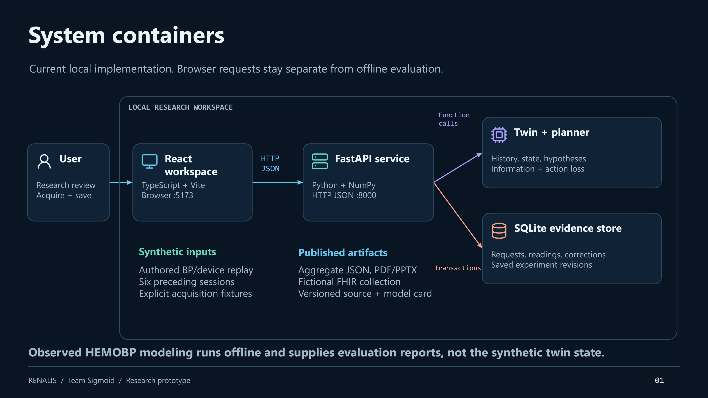
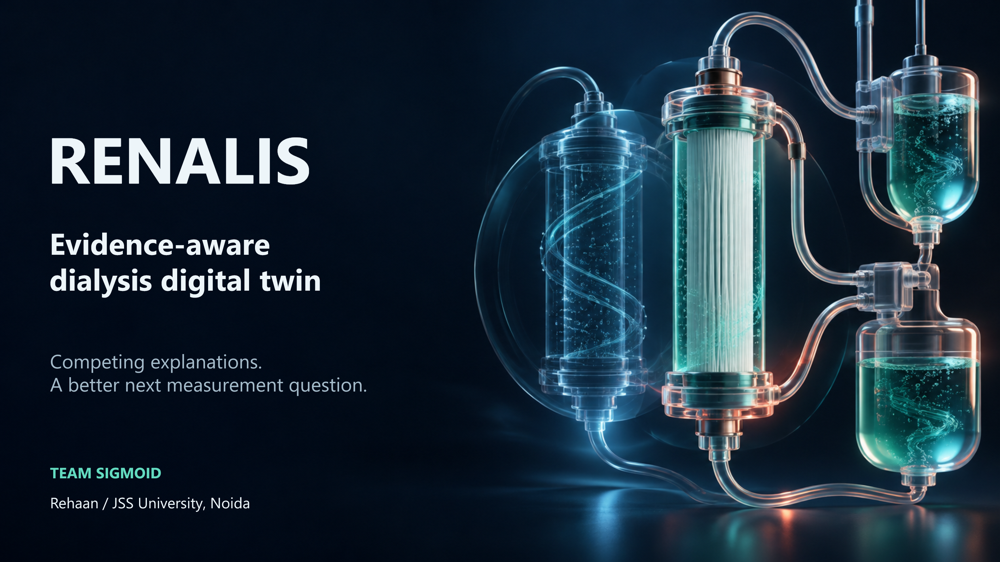
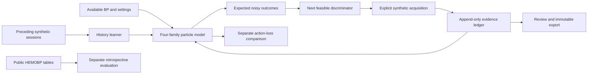

# RENALIS — Evidence-aware Dialysis Digital Twin

**Team Sigmoid · Rehaan (solo) · JSS University, Noida**

Hackathon research prototype · Final submission materials, 20 October 2026

**Public source:** [RAK2315/RENALIS](https://github.com/RAK2315/RENALIS).

RENALIS connects preceding-session learning, competing physiological explanations, and the next feasible evidence question in a dialysis research workspace. It shows what the model assumes, what an acquired reading changes, and what remains uncertain.

## Team details

- **Team:** Sigmoid
- **Member:** Rehaan — solo entrant; project design, development and submission
- **College:** JSS University, Noida

## Demo video

**20-minute narrated demo:** [Watch the unlisted video](https://www.youtube.com/watch?v=ZcWNYMtM1tI). **Source:** [Public GitHub repository](https://github.com/RAK2315/RENALIS).

The uploaded video is **20:00**, **Unlisted**, and available without signing in. YouTube player metadata was checked anonymously on 20 October 2026. [Submission verification record](docs/submission-verification.json).

Four chapters: **00:00** problem and architecture · **05:00** adaptive CO→RBV investigation · **10:00** evidence and evaluations · **15:00** robustness, reproducibility and next steps. See [upload checklist](docs/UPLOAD_NEXT.md).

## Problem statement and healthcare use case

Similar BP histories can fit different hidden physiological processes and hypothetical fluid-removal responses. A single risk score does not show which explanation is supported or which additional observation could resolve the disagreement.

RENALIS supports **research review during maintenance hemodialysis**: inspect available measurements, compare authored hypotheses, explore hypothetical profiles and document a next evidence question. All built-in patients and device streams are synthetic. No treatment commands are sent to a machine, and no clinical diagnosis or prospective patient benefit is claimed.

## The distinctive workflow

1. **Learn:** fit a refill prior from six preceding completed synthetic sessions, with source fits, shrinkage uncertainty and lineage.
2. **Understand:** inspect fluid compartments and authored physiological maps in a clickable graph.
3. **Compare:** retain volume/refill, vascular, cardiac and mixed hypotheses,48 particles each.
4. **Ask:** predict noisy possible observations and select an available discriminator from the current posterior.
5. **Review:** acquire the device result, retain failures/artifacts, append corrections and save immutable investigations.
6. **Verify:** inspect separate retrospective and independent synthetic evaluation results, including negative findings.

**Concrete example:** at Meera minute 90, acquired CO **3.74 L/min** leaves cardiac **51.7%** and volume **46.2%** support. The planner selects **relative blood volume** because their predicted distributions differ. Acquired RBV **85.0%** shifts support to volume **66.9%** and cardiac **31.8%**, retaining ambiguity. No manual resolving number is required. [Click-by-click walkthrough](docs/demo-walkthrough-v04.md#adaptive-follow-up-after-374-lmin).

Information and decision value are separate objectives. A measurement can distinguish hypotheses while failing to improve the modeled action after waiting, burden and failure. Model support is not a diagnostic probability.

## Architecture and project presentation

The current materials use six architecture views and a 20-slide presentation. Labels, diagrams and charts remain editable in PowerPoint.

- [Architecture diagram — PDF](output/pdf/RENALIS_Architecture_v06.pdf) · [editable PPTX](output/presentations/RENALIS_Architecture_v06_Professional_Final.pptx)
- [Project details and outcomes — PDF](output/pdf/RENALIS_Project_Presentation_v06.pdf) · [editable PPTX](output/presentations/RENALIS_Project_Presentation_v06_Design_Final.pptx)
[](output/pdf/RENALIS_Architecture_v06.pdf)

[](output/pdf/RENALIS_Project_Presentation_v06.pdf)

- [Detailed research dossier](output/pdf/RENALIS_Research_Strategy_and_Master_Plan.pdf) · [implementation decisions](docs/implementation-decisions-v04.md)



## Technical stack and AI/ML details

React, TypeScript, Vite, Recharts and Lucide provide the interface. FastAPI, NumPy and SQLite implement inference, experiment design and persistence. pandas and scikit-learn support the separate observed-data evaluation. Python dependencies are pinned in `requirements-lock.txt`; Node dependencies use `package-lock.json`.

The physiological path uses a likelihood-based preceding-session learner, particle state estimation, four authored response families, Gaussian observation likelihoods and numerical quadrature. The new sequential selector ranks pair-conditional expected entropy reduction when two families retain at least 10% support; otherwise it considers whole-bank information. Noise, failure, equipment, evidence availability and existing authority guards constrain selection. Repeated observations currently assume independent noise.

The whole-policy selector separately computes expected action-loss reduction with waiting, failure and burden. The retrospective path has patient-separated fit/calibration/test sets and baseline, history and calibration models. See the [current model card](docs/model-card.md) for equations, assumptions, limitations and intended use.

## Evaluated outcomes and limits

| Task | Actual result | Interpretation |
|---|---|---|
| Observed HEMOBP, 61,947 windows / 176 test patients | MAE 12.194 persistence; 11.356 dynamic; 11.328 demographics+dynamic; 11.161 with preceding history | Separate retrospective task; no physiological identification |
| Paired history increment | −0.1665 mmHg; patient-cluster interval [−0.2298,−0.1099] | Small predictive contribution; clinical importance not established |
| Next-measured-reading event | Sensitivity 61.25%; PPV 13.51%; nominal 90% coverage 86.74% | Missed events, false alerts and undercoverage remain visible |
| Independent 192-case policy holdout | Mean regret 0.22170 fixed cuff; 0.24145 decision value; lower is better | No overall decision-value superiority |
| New sequential discriminator | Actual CO→RBV workflow and numerical/software checks pass | Independent multi-acquisition policy evaluation is still planned |

The observed cohort assumes an empirical eight-hour cross-table clock alignment needing independent confirmation. Only 2,516,989 of 4,366,298 packets match the declared interval/elapsed checks; exclusions may bias results. The next-distinct-measured-reading endpoint differs from continuous hypotension and modeled 30-minute crossings.

[Observed aggregate report](docs/observed-v04.json) · [frozen policy report](docs/policy-validation-v04.json) · [preserved initial report](docs/policy-validation-v04-initial.json). No raw observed records are redistributed.

## Run locally and reproduce

Use Python 3.10 and Node 22.12 or later. Local verification used Python 3.10 and Node 24.

```powershell
python -m venv .venv
.venv/Scripts/python.exe -m pip install -r requirements-lock.txt
npm ci
```

In separate terminals:

```powershell
.venv/Scripts/python.exe -m uvicorn backend.app:app --host 127.0.0.1 --port 8000
npm run dev
```

Open `http://127.0.0.1:5173/workspace?view=investigation&patient=RNL-014&minute=90`. The Windows convenience launcher is `scripts/start.ps1`. Linux/macOS use `.venv/bin/python` in place of `.venv/Scripts/python.exe`.

```powershell
.venv/Scripts/python.exe -m unittest discover -s tests -v
npm run build
.venv/Scripts/python.exe scripts/verify-release.py
npm run test:browser:journey
npm run test:browser:adaptive
```

The current release passed 50 backend tests, production build and isolated browser checks across 320/390/768/1024/1440-pixel layouts. Browser scripts need Playwright; footage checks use a compiled preview on 5174 and an isolated API/database. CI verifies backend tests, production build and aggregate-release contracts. Software checks do not establish clinical validity.

Observed evaluation reproduction requires the separately obtained, checksum-verified permitted HEMOBP v3 tables. See `scripts/evaluate_observed_v04.py` and [evaluation protocol](docs/evaluation-protocol-v04.json). Filming/rendering instructions are in [video production README](video/submission_v05/README.md); optional voice/runtime dependencies are separate from the application.

## License, attribution and future evidence

Code is licensed under [MIT](LICENSE). See [third-party notices](THIRD_PARTY_NOTICES.md) for data, dependency, icon, voice/runtime and model terms. The local film uses synthetic Kokoro narration and an original procedural score. No human voice is impersonated.

Clinical collaborators, approvals, paired physiological calibration, an expert task study, external silent validation, workload assessment, live integration and prospective impact remain future work. [Study protocol](docs/clinical-study-protocol.md) · [capture schema](docs/data-capture-schema.json). Synthetic FHIR export is an example, not ABDM certification.

## Organizer submission checklist

| Mandatory README item | Location/status |
|---|---|
| Team details | Included: [Sigmoid; Rehaan; solo entrant](#team-details) |
| College/incubator | Included: [JSS University, Noida](#team-details) |
| Project title | Included: RENALIS — Evidence-aware Dialysis Digital Twin |
| Problem statement | Included: [problem statement](#problem-statement-and-healthcare-use-case) |
| Healthcare use case | Included: [maintenance hemodialysis research review](#problem-statement-and-healthcare-use-case) |
| Technical stack | Included: [technical stack](#technical-stack-and-aiml-details) |
| AI/ML model/framework details | Included: [model/framework details](#technical-stack-and-aiml-details) and [model card](docs/model-card.md) |
| 15–20 minute unlisted YouTube demo | Verified: [Unlisted 20:00 demo](https://www.youtube.com/watch?v=ZcWNYMtM1tI) |
| Open-source license | Included: [MIT](LICENSE) and [third-party notices](THIRD_PARTY_NOTICES.md) |
| Architecture diagram PDF/PPT | Included: [PDF](output/pdf/RENALIS_Architecture_v06.pdf) and [editable PPTX](output/presentations/RENALIS_Architecture_v06_Professional_Final.pptx) |
| Presentation PDF/PPT with details/outcomes | Included: [PDF](output/pdf/RENALIS_Project_Presentation_v06.pdf) and [editable PPTX](output/presentations/RENALIS_Project_Presentation_v06_Design_Final.pptx) |
| All files and links publicly accessible | Verified: public repository, anonymous linked-file downloads, and video player access; see [verification record](docs/submission-verification.json) |

[Final submission steps](docs/UPLOAD_NEXT.md) · [submission checklist](docs/submission-checklist.md) · [team metadata](docs/team.json). The repository and video are published. Organizer form submission and its receipt remain the entrant's final step.
